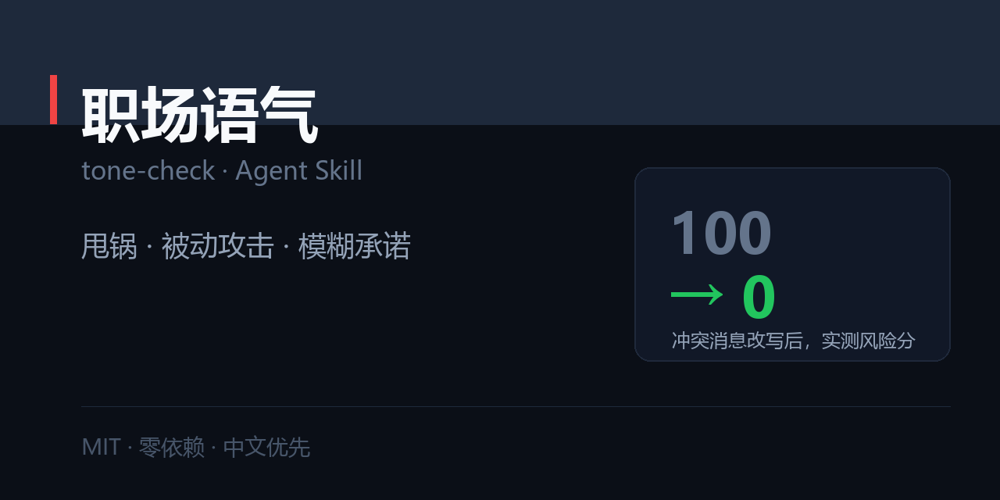

# 职场语气检测 · tone-check

> 同一件事，三种说法，三种结局。指出哪句话会被读成敌意，并给出保留原意的改写。



[](./SKILL.md)
[](./LICENSE)
[](#)

---

## 一句话

```
$ python scripts/scan_tone.py message.txt --explain

风险分：100/100    高概率被读成敌意：建议整段重写
命中 15 句：高危 11 · 中危 4 · 提醒 0

  [高危]「我之前说过」（第 1 行，甩锅）
       对方会读成：你在撇清责任，暗示是我的错
       改写：「可能我没说清楚，我再确认一遍：…」
  [高危]「你自己看」（第 1 行，甩锅）
       对方会读成：自己去找，别烦我
       改写：「在文档第 3 节，具体是：…」
  [高危]「呵呵」（第 3 行，被动攻击）
       对方会读成：我在鄙视你
       改写：（删掉，什么都别加）
  [高危]「尽快」（第 5 行，模糊承诺）
       对方会读成：我不知道什么时候，也不会催你
       改写：「今天 18:00 前给你初版」
```

改写后的干净版本跑出来是 **0 分**。

---

## 核心理念

> 测的是「对方会怎么读」，不是「你的本意」。

你没想甩锅，但对方读到了甩锅，那就是甩锅。

而且——**大量「语气问题」其实是责任不清**。说清谁做什么什么时候，语气自然就缓和了。

## 安装

```bash
git clone https://github.com/zhbehx/tone-check.git ~/.claude/skills/tone-check
```

## 用法

```bash
python scripts/scan_tone.py message.txt
python scripts/scan_tone.py message.txt --explain     # 看对方会读成什么
python scripts/scan_tone.py message.txt --fail-over 60
python scripts/scan_tone.py message.txt --json
```

## 五个维度

| 维度 | 典型说法 | 对方的读法 |
| --- | --- | --- |
| 甩锅 | 「我之前说过」「这不是我负责的」 | 你在撇清，暗示是我的错 |
| 被动攻击 | 「呵呵」「随便」「你开心就好」 | 你有意见但不说，等着看笑话 |
| 模糊承诺 | 「尽快」「我看看」「应该没问题」 | 你没打算做，或者没当回事 |
| 命令式 | 「马上」「必须」「我不管」 | 你把我当执行工具 |
| 责任稀释 | 「大家」「相关同学」 | 没人负责，等于没人做 |

**分档**：≥60 必须改 ｜ 30–59 改最刺的一两句 ｜ <30 基本安全

## 通用改写公式

> **事实 + 影响 + 请求 + 时间**

❌ 「这个怎么还没好？我等着用呢。」

✅ 「这个接口现在还没联调（事实），我这边联调卡着（影响），能不能今天下班前先给个能跑的版本（请求），我明早接着测（时间）。」

四段齐了，语气自然中性——因为对方听到的是信息，不是情绪。

## 脚本还会提示「该换渠道」

有些话不适合打字，脚本会单独列出：

- 涉及绩效 / 薪资 / 晋升 → 当面说
- 要指出具体某个人的失误 → 只对当事人当面说
- 涉及离职 / 辞退 / 裁员 → 当面 + 书面流程

## 三个不该改的地方

不是所有「不好听」都要改：

1. **明确拒绝**：「这个我做不了，因为它需要 X，而我没有。」清楚比客气重要。
2. **指出事实冲突**：「你说的数据和后台不一致，我的口径是 X。」这不是甩锅，这是对齐。
3. **设定边界**：「这个需求今天加不进来，最早下周二。」比含糊答应更专业。

**别把「保护自己」当成「语气不好」。**

## 仓库结构

```
tone-check/
├── SKILL.md                      # 三原则 + 五维 + Step 0–5 + 反模式
├── references/
│   └── tone-patterns.md          # 60+ 组对照：原句 → 对方的读法 → 改写
├── scripts/
│   └── scan_tone.py              # 五维扫描 + 换渠道提示
├── examples/
│   └── 01-tone-fix.md            # 完整诊断与改写
└── market/social-preview.png
```

## 三个诚实的局限

1. **读不出关系与语境。** 同样一句「行吧」，对熟人是对平级是敷衍，对老板可能是顺从。
2. **规则式匹配会有误报。** 「必须」在需求文档里完全正常。
3. **它不教你「变得圆滑」。** 目标是让事说清楚，不是让话说好听。

## 相关 skill

- **内容与写作**：[爆款文案工坊](https://github.com/zhbehx/viral-copy) · [AI 味检测器](https://github.com/zhbehx/ai-tell)
- **职场五件套**：[简历对岗改写](https://github.com/zhbehx/resume-tailor) · [面试陪练](https://github.com/zhbehx/interview-coach) · [汇报写作](https://github.com/zhbehx/weekly-report) · [PPT 叙事大纲](https://github.com/zhbehx/slide-story) · [会议纪要](https://github.com/zhbehx/meeting-actions)
- **避坑与决策**：[JD 红旗检测](https://github.com/zhbehx/jd-redflag) · [合同风险扫描](https://github.com/zhbehx/contract-redflag) · [会议成本](https://github.com/zhbehx/meeting-cost)
- **发布与沟通**：[隐私自查](https://github.com/zhbehx/privacy-scan)

共同点：零依赖、中文优先、每个都带一个确定性检查脚本。

## 自定义

1. **加你们团队的口头禅**：`scripts/scan_tone.py` 的 `RULES` 加一条正则。
2. **改权重**：`LEVEL_PENALTY`（H=12 / M=6 / L=2）。
3. **加换渠道规则**：`CHANNEL_WARNINGS`。

## FAQ

**Q：会不会让我说话变得假客气？**
A：反了。它建议的改写大多更**直接**——「今天 18:00 前给你初版」比「我尽快」强硬得多，也更专业。

**Q：对老板也能用吗？**
A：能用，但风险阈值不同。同一句「必须」，对下属是可接受的推进，对老板就是冒犯。脚本不看关系，你需要自己调整。

**Q：为什么「大家看一下」算高危？**
A：因为具名才能落地。@三个人各一条，比「大家一起看」有效十倍——这也是为什么它归在「责任稀释」。

## License

[MIT](./LICENSE)
